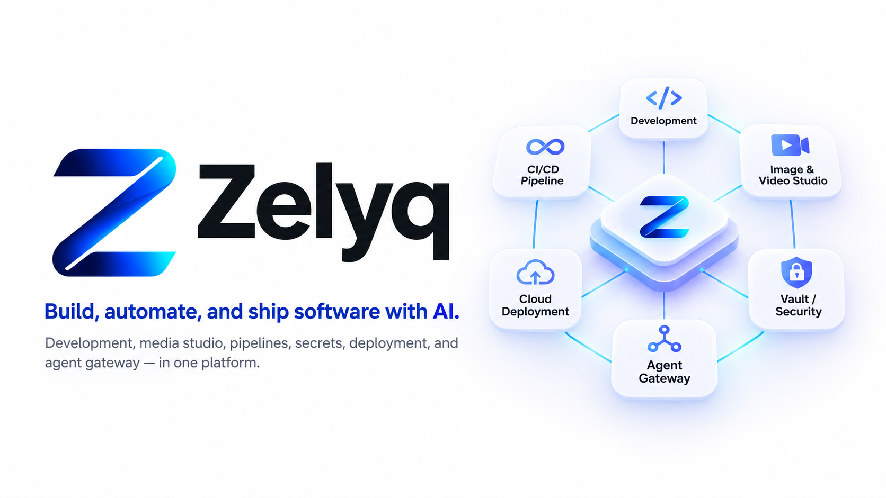

<div align="center">



**English** · [Français](./README.fr.md) · [Deutsch](./README.de.md) · [Español](./README.es.md) · [Português](./README.pt-BR.md) · [简体中文](./README.zh-CN.md) · [हिन्दी](./README.hi.md) · [Italiano](./README.it.md) · [日本語](./README.ja.md)

### The open-source developer platform: build, secure, ship and run software in one place.

Build apps with an AI agent that works like an engineer. Keep every credential in one encrypted vault.
Test and deploy on your own machines, and let an AI DevOps engineer look after what runs.
**Self-host it or use it hosted. Bring your own model. No telemetry.**

[](https://github.com/CrowPus/Zelyq/actions/workflows/ci.yml)
[](./LICENSE)
[](https://nodejs.org)
[](./tsconfig.base.json)
[](./CONTRIBUTING.md)

**[Website](https://zelyq.dev)** · **[Try it hosted](https://app.zelyq.dev)** · [Quickstart](#quickstart) ·
[Tutorial](./docs/tutorial.md) · [Documentation](./docs/README.md) · [Self-hosting](./docs/self-hosting.md) ·
[Architecture](./docs/architecture.md) · [Roadmap](./docs/roadmap.md) · [Contributing](./CONTRIBUTING.md)

</div>

---

## Contents

- [Why Zelyq](#why-zelyq)
- [The platform](#the-platform): [Apps](#apps), [Studio](#studio), [Agents](#agents), [Vault](#vault),
  [Pipelines](#pipelines), [Deployments](#deployments), [Ops](#ops)
- [Teams, plans and languages](#teams-plans-and-languages)
- [Quickstart](#quickstart) and [updating](#updating)
- [Bring your own model](#bring-your-own-model)
- [How it works](#how-it-works)
- [Security](#security) · [Status](#status) · [Contributing](#contributing) · [License](#license)

---

## Why Zelyq

Shipping software usually takes several products: an AI app builder, a secrets manager, a CI
service, a deploy tool and someone on call. That means several logins, several bills and several
places for a key to leak. Zelyq puts the whole path in one platform, organised the way the work
happens:

| | Module | What it does |
| --- | --- | --- |
| **Build** | **[Apps](#apps)** | Describe an app. An agent plans it, builds it in real files you own, and checks it before calling it done |
| | **[Studio](#studio)** | Generate images and video, for your apps or on their own |
| | **[Agents](#agents)** | Let Claude Code, Cursor, VS Code, Gemini CLI or any MCP client work inside Zelyq, on its own model |
| **Secure** | **[Vault](#vault)** | Every credential stored once, encrypted, versioned and audited, and used by apps, pipelines and your own servers |
| **Ship** | **[Pipelines](#pipelines)** | Test and build the same way every time, on the Zelyq server or your own Linux, macOS and Windows machines |
| | **[Deployments](#deployments)** | Put apps on your machines per environment, with approvals, freeze and automatic roll back |
| | **[Ops](#ops)** | An AI DevOps engineer you can talk to: it plans, waits for your approval, proves every change, and watches what runs |

Everything belongs to a **team**. Invite people, give each a role, and every module follows it.

---

## The platform

### Apps

Describe what you want. The agent reads, plans, writes files, runs commands and starts a live
preview. You can see every tool call and every file it touches as it works.

- **Checked, not just generated.** When the agent finishes, Zelyq runs the project's own typecheck
  or build and checks the preview for a crash. A turn that broke something goes back to the agent to
  fix instead of being reported as done.
- **Clear about what it knows.** *Engineer Mode* separates what was verified from what was assumed,
  names the alternative it did not choose, and asks before anything irreversible.
- **Plans before it builds.** *Architect Mode* turns a request into a design you can review
  (requirements, decisions, data model, API, build plan) and waits for your go-ahead. *Auto Mode*
  then carries out the plan by itself, up to a set limit.
- **Specialists on call.** A Designer (`DESIGN.md`), a DevOps engineer (CI, Dockerfile, deploy
  config), a Security/QA engineer (tests and a security scan) and a Cinematic engineer
  (scroll-driven pages).
- **Full stack.** React + Vite, React with a Python (FastAPI) backend, or Expo React Native, each
  starting from a design system. Supabase Postgres with row-level security per operation.
- **Start from what exists.** Import a GitHub repository, rebuild a live site with `/clone <url>`,
  or build from a Figma frame and its design tokens with `/figma <link>`.
- **Every turn can be undone.** A snapshot before each turn, a diff of exactly what changed, and a
  one-click revert. Projects are plain files on disk that you can take with you.

See [Modes](./docs/modes.md) and [how the agent behaves](./docs/agent-behaviour.md).

### Studio

- **Image**: OpenAI, Google or xAI, with reference images and a private library.
- **Video**: Google Veo or xAI, from text or from a still image.

Studio uses your own provider keys, billed to your own account. Turn it on for a project and the
agent can make artwork and footage for the app it is building, within the limits you set. Clips can
be split into image sequences for scroll-driven pages. See
[Studio: Image](./docs/Image-gen/implementation.md) and [Studio: Video](./docs/Video-gen/README.md).

### Agents

Bring the AI tool you already use. An **agent** lets Claude Code, Cursor, VS Code, Gemini CLI,
ChatGPT or any MCP client work inside Zelyq with its own model and subscription. Zelyq gives it
access to only the apps, pipelines and environments you choose.

- **Permissions you set one by one**: Off, Allowed or Needs approval, for reading and writing code,
  running commands, pushing, pipelines, deployments, Studio and more.
- **A person approves what matters.** Pushes, pipeline runs and deployment changes are requests that
  wait in the Inbox.
- **Safe to undo.** An undo point is taken before the agent changes an app.
- **Secret values are never shown.** The agent sees which secrets an app receives, by name only.

See [Agents](./docs/agents.md).

### Vault

Store each credential **once** and use it everywhere, without pasting it into a file.

- **Encrypted at rest** (AES-256-GCM), with **version history**, a **Protected** flag for live keys,
  and a record of every reveal and change.
- **Used by reference.** App variables, model keys, pipelines and environments point to
  `vault://NAME`. The value is filled in only where and when it is needed.
- **Masked in logs.** A secret that reaches a pipeline log shows as `***`.
- **Your own servers too.** Fetch secrets with a scoped service key, or run
  `zelyq vault run -- <command>` to start a process with them, writing nothing to disk.
- **Move in with a `.env` import.**

See [Vault](./docs/vault.md).

### Pipelines

A pipeline is a short YAML file, or a picture you edit by clicking. Stages run in order, steps run
in order, and every step is a command or a ready-made block.

```yaml
name: Shop
runs-on: local                      # the Zelyq server, or one of your machines
source: { app: Shop }
stages:
  - name: Test
    matrix: { node: [20, 22] }      # one copy per version, at the same time
    steps:
      - checkout: true
      - setup: node@${{ matrix.node }}
      - run: npm ci && npm test
        tests: reports/*.xml        # JUnit: passed / failed on the step
  - name: Deploy
    steps:
      - deploy: { to: production, port: 3000 }
```

- **Runs where you choose.** In a throwaway container on the Zelyq server, or on your own **Linux,
  macOS and Windows** machines. A machine joins with one install command and connects out to Zelyq
  over HTTPS, so it needs no open ports. Machines reached over SSH are supported too.
- **Fast and flexible.** Stages that run at the same time, a different machine per stage, matrix
  builds, and templates shared across pipelines.
- **Plugins.** Package a step once, with inputs, secrets from Vault and outputs, then use it in any
  pipeline. See [Pipeline plugins](./docs/pipeline-plugins.md).
- **Started by anything.** By hand, a git push (with path filters), a pull request, a schedule,
  another pipeline finishing, an app change from the agent, or any CI with a service key.
- **Everything a real pipeline needs.** Tool setup and caches, service containers (Postgres, Redis),
  step outputs, JUnit reports, artifacts, approvals, retries, timeouts and concurrency control.
- **Reports back.** ✓ / ✗ on the commit and the pull request in GitHub or GitLab.

See [Pipelines](./docs/pipelines.md).

### Deployments

- **Environments** such as `staging` and `production`, each on one of your machines, each with its
  own variables. Use the test key on staging and the live key on production, both from Vault.
- **Deploy from a pipeline**, so an app is tested before it ships. Zelyq builds the image on your
  machine, from the app's `Dockerfile` or one it writes for Node, Python, Go and static sites. No
  registry needed.
- **Automatic roll back.** If the new version fails its health check, the previous one is put back
  by itself.
- **Your own domain with HTTPS** and no downtime between versions.
- **Live logs, CPU and memory**, restart and stop, and one-click roll back to an earlier version.
- **Promote** the exact image tested on staging to production, without building it again.
- **Protected environments** wait for an admin's approval. **Freeze** stops all deploys during a
  release.

See [Deploy](./docs/deploy.md).

### Ops

**Ops** is the team's DevOps engineer. Ask it, typed or aloud, to put an app online, ship a new
version, set up a domain, or explain why something is slow.

- **It looks first and shows a plan.** Ops looks freely, but every change is a list of exact steps
  that waits for your approval. A step that cannot be undone is confirmed on its own.
- **It proves every change.** Zelyq checks the result itself. A step counts as done only when its
  check passes.
- **It never stops watching.** Websites and apps are checked every minute, machines every five
  minutes, certificates and domains every day, without using a model. Alerts reach you by email,
  Telegram, Slack or Discord.
- **It reaches only what you assign.** An admin gives it environments, machines, pipelines and code,
  one by one, with a trust level for each. It sees secret names, never their values.
- **It remembers.** Rules you give it and lessons from what went wrong are kept and read before
  every job.
- **You stay in control.** A monthly spending limit, and **Pause Ops** stops everything at once.

---

## Teams, plans and languages

| Role | Can |
| --- | --- |
| `viewer` | See apps, files, runs, environments and deploy history |
| `editor` | Everything above, plus prompt the agent, run pipelines and deploy |
| `admin` | Everything above, plus members, agents, environments, approvals and protected secrets |
| `owner` | Full control, including the team itself |

- **Activity.** Every change is recorded in the team's Activity: a secret revealed, a pipeline
  edited, a deploy rolled back.
- **Plans and usage.** Each team gets limits for apps, storage, pipeline runs, members and previews,
  set by the server's admin.
- **Running Zelyq for others.** [Managed mode](./docs/managed-mode.md) puts sign-in behind your
  own account service, and the [admin API](./docs/admin-api.md) lets your systems manage people,
  teams, plans and health.
- **Nine languages.** The interface and its built-in help are in English, French, German, Spanish,
  Portuguese, Chinese, Hindi, Italian and Japanese, chosen per person.
- **Idle apps sleep.** Apps nobody has opened for a while can move to an S3-compatible bucket or a
  folder, and wake by themselves when opened. See [Storage](./docs/storage.md).

---

## Quickstart

**The quickest way:** create an account at **[app.zelyq.dev](https://app.zelyq.dev)**. There is a
free plan, and nothing to install.

**To run it yourself:**

```bash
# Requires Node >= 20.12 and pnpm >= 9
git clone https://github.com/CrowPus/Zelyq.git
cd Zelyq
cp .env.example .env    # your configuration: check it before the first start (below)
pnpm install
pnpm dev                # web :5173 · server :8787 · agent :8788
```

Open <http://localhost:5173> and create the first account. That account administers the instance.
Add your model's key in **Settings → Model** (typed, or from Vault), open **Apps**, create an app
and describe what you want.

**On a VM or a remote server**, change these in `.env` before the first start. Replace
`203.0.113.10` with your machine's address or domain:

| Setting | Set it to | Why |
| --- | --- | --- |
| `ZELYQ_WEB_HOST` | `0.0.0.0` | Otherwise the web UI only answers on the machine itself |
| `ZELYQ_PREVIEW_HOST` | `203.0.113.10` | Otherwise app previews refuse your browser |
| `ZELYQ_CORS_ORIGIN` | `http://203.0.113.10:5173` | The address you open Zelyq at |
| `ZELYQ_PUBLIC_URL` | `http://203.0.113.10:5173` | Used in webhook and sign-in links |
| `ZELYQ_ALLOW_REGISTRATION` | `false`, once your account exists | Otherwise anyone who finds the address can sign up |

Open port 5173 and the preview ports (`ZELYQ_PREVIEW_PORT_MIN`–`MAX`, 4300–4399 by default) in the
firewall. On a machine reachable from the internet, put Zelyq behind HTTPS: see
[Self-hosting](./docs/self-hosting.md). Every other setting is explained in `.env.example` and in
[Configuration](./docs/configuration.md).

**With Docker:** `docker compose -f docker/docker-compose.yml up`. See
[Self-hosting](./docs/self-hosting.md).

**Next:** the [tutorial](./docs/tutorial.md) takes an app from Zelyq to production, step by step:
Vault, a pipeline, your own machine, a deploy with roll back, and GitHub pushes and pull requests.

### Updating

Your data stays where it is. The database, generated media and the encryption key live in `data/`,
your apps in `workspace/` and your settings in `.env`. Git ignores all three, and the server applies
database changes itself when it starts.

```bash
cd ~/Zelyq                                    # wherever you cloned it
# 1. Stop Zelyq (Ctrl+C if it runs as `pnpm dev`)

# 2. Back up first
cp -a data ~/zelyq-data-backup-$(date +%F)
cp -a workspace ~/zelyq-workspace-backup-$(date +%F) 2>/dev/null
cp .env ~/zelyq-env-backup-$(date +%F) 2>/dev/null

# 3. Get the new version and rebuild
git pull
pnpm install
pnpm build

# 4. Start Zelyq again the same way as before
```

Run these as the user who cloned Zelyq. If Git stops with `detected dubious ownership`, switch to
that user with `su - <user>` rather than adding a `safe.directory` exception.

With Docker: `git pull`, then `docker compose -f docker/docker-compose.yml up -d --build`. Your data
is in the `zelyq-data` volume, so **never** run `docker compose down -v`, which deletes it.

More detail, including PostgreSQL: [Self-hosting → Upgrading](./docs/self-hosting.md#upgrading).

---

## Bring your own model

| Provider | `ZELYQ_PROVIDER` | Default model |
| --- | --- | --- |
| Claude | `anthropic` | `claude-opus-5-5` |
| Gemini | `google` | `gemini-pro-latest` |
| OpenAI | `openai` | `gpt-6.1-terra` |
| Grok (xAI) | `xai` | `grok-4.6` |
| DeepSeek | `deepseek` | `deepseek-v4-flash` |
| Mistral | `mistral` | `mistral-large-latest` |
| Groq | `groq` | `llama-3.3-70b-versatile` |
| OpenRouter | `openrouter` | `anthropic/claude-sonnet-4.6` |
| **Your own**: Ollama, vLLM, LM Studio, anything OpenAI-compatible | `custom` | set `ZELYQ_MODEL` |

Set keys in **Settings → Model**, typed or from Vault, or let each team bring its own in **Team
settings → AI keys**. A Claude Code or Codex sign-in can stand in for an API key. With `custom`,
nothing about your projects leaves your network. See [Configuration](./docs/configuration.md).

---

## How it works

Three processes and a command-line tool, built on four shared libraries. An app's files and
commands are reached through one path only, the `RuntimeDriver`, which is what makes local,
container and remote work the same way.

```
   Browser                                 zelyq CLI  (zelyq vault run …)
      │                                        │
      │  REST + WebSocket                      │  HTTPS, service key
      ▼                                        ▼
 ┌──────────────────────────────────────────────────────────┐
 │ apps/server   Fastify · owns the database                │
 │ teams · apps · Vault · pipelines · deploys · Ops         │
 └────┬───────────────────────┬─────────────────────┬───────┘
      │ HTTP + SSE            │                     │ outgoing HTTPS or SSH
      ▼                       │                     ▼
 ┌──────────────┐             │             ┌────────────────────────────┐
 │ apps/agent   │             │             │ Runners and environments   │
 │ model loop,  │             │             │ your Linux, macOS, Windows │
 │ tools        │             │             │ machines: pipelines,deploys│
 └──────┬───────┘             │             └────────────────────────────┘
        │                     │  files, previews, snapshots
        ▼                     ▼
 ┌──────────────────────────────────────────────────────────┐
 │ RuntimeDriver   the only path to disk and shell          │
 │ local · container (one per project) · remote host        │
 └──────────────────────────────────────────────────────────┘
```

| Part | Responsibility |
| --- | --- |
| [`apps/web`](./apps/web) | The interface: chat, editor and preview, Studio, Vault, Pipelines, Deployments, Ops |
| [`apps/server`](./apps/server) | Teams, apps, Vault, the pipeline engine, deploys and Ops; the only process that talks to the database |
| [`apps/agent`](./apps/agent) | The model loop. It never touches files itself: every tool goes through the `RuntimeDriver` |
| [`apps/runner`](./apps/runner) | The runner installed on your machines; it connects out to Zelyq and runs pipelines and deploys |
| [`apps/cli`](./apps/cli) | The `zelyq` command line, e.g. `zelyq vault run` |
| [`apps/registry`](./apps/registry) | The signed plugin registry |
| [`@zelyq/core`](./packages/core) | Domain types, the pipeline file format and the wire protocol |
| [`@zelyq/runtime`](./packages/runtime) | `RuntimeDriver` and its implementations; the only code that starts processes |
| [`@zelyq/db`](./packages/db) | Drizzle schema and migrations: SQLite by default, PostgreSQL when you scale |
| [`@zelyq/tools`](./packages/tools) | The agent's tools, written once against `RuntimeDriver` |

Full detail: [Architecture](./docs/architecture.md).

---

## Security

Zelyq is built to be inspected: simple storage, plain files, no telemetry, and secrets that are
encrypted at rest and never put on a command line or in a log. Know these limits before you
deploy:

- **`local` runtime mode is not a sandbox.** Agent commands run as the server's user. Use it for
  one trusted developer on one machine. For anything shared or internet-facing, set
  `ZELYQ_RUNTIME=container`.
- **Container mode's outbound network is open by default.** It always blocks the cloud metadata
  endpoint and traffic between projects. Set `ZELYQ_CONTAINER_EGRESS_ALLOWLIST` to restrict the
  rest, or use the [strict sandbox](./docs/strict-sandbox.md) for untrusted code.

Read the [threat model](./SECURITY.md#threat-model--read-this-before-deploying) before deploying,
and report vulnerabilities privately as described in [SECURITY.md](./SECURITY.md).

## Status

Zelyq is **early and moving fast**. Apps, Studio, Agents, Vault, Pipelines, Deployments and Ops all
work end to end and are used every day. Expect breaking changes before `1.0`. See the
[roadmap](./docs/roadmap.md).

## Contributing

Issues, discussions and pull requests are welcome. [CONTRIBUTING.md](./CONTRIBUTING.md) covers the
development loop, the repository layout and where a change usually belongs. Before opening a pull
request, run `pnpm lint`, `pnpm typecheck` and `pnpm test`. Everyone taking part follows the
[Code of Conduct](./CODE_OF_CONDUCT.md).

## License

Zelyq is **open source** under the [GNU AGPL-3.0](./LICENSE): run it, change it, self-host it,
fork it. If you run a *modified* Zelyq as a service for others over a network, the AGPL requires
you to offer them your source.

A **commercial license** (the same code without the AGPL's network-source requirement) is available
for closed-source products and organisations whose policy rules out AGPL software:
**support@dee-empire.com**. Features marked "Zelyq Enterprise" (`ee/` paths) are a separate
subscription under the [Zelyq Enterprise License](./LICENSE_EE.md). [LICENSING.md](./LICENSING.md)
explains it in plain language. Releases up to and including `v0.1.0` remain available under
Apache-2.0.

<div align="center">
<br />

© 2026 [Dee Empire](https://dee-empire.com) · "Zelyq" and the Zelyq logo are trademarks of Dee Empire.

</div>
