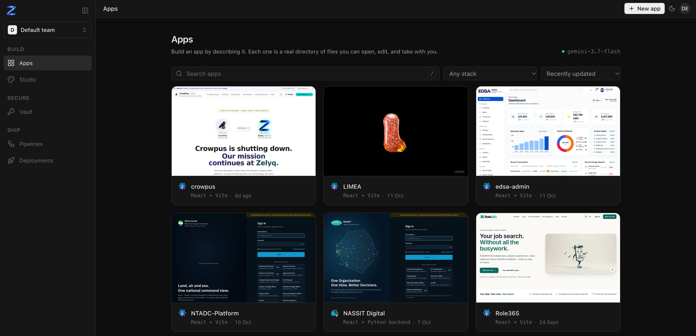
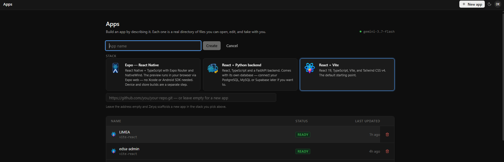
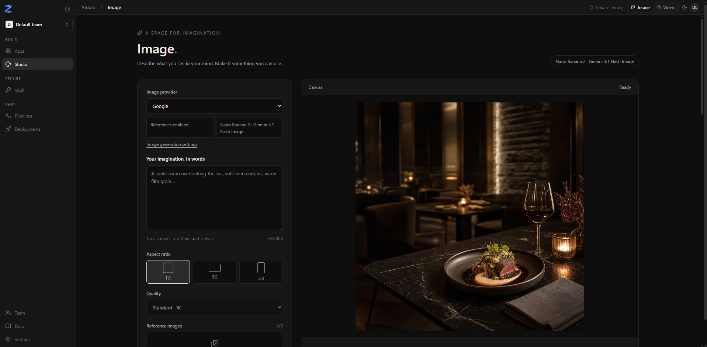
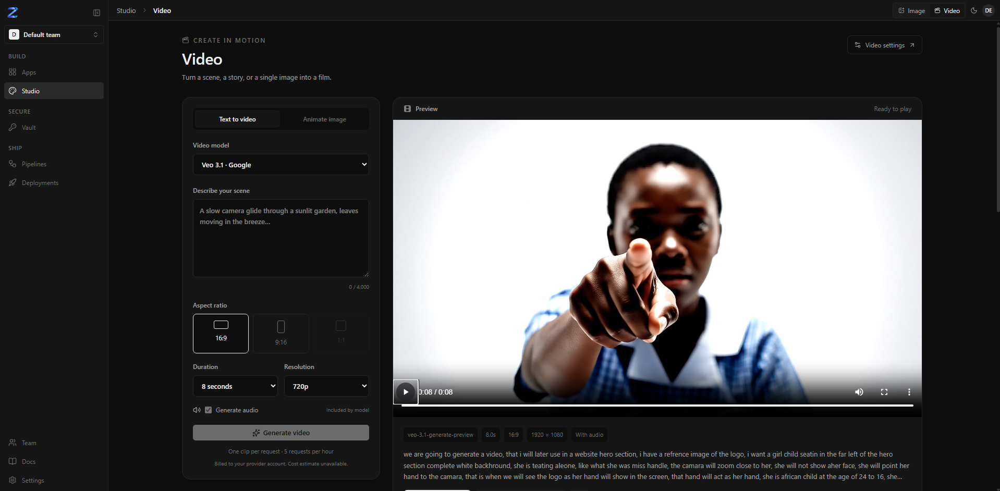
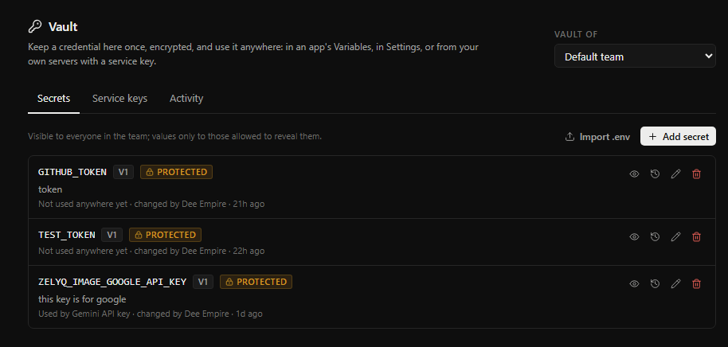
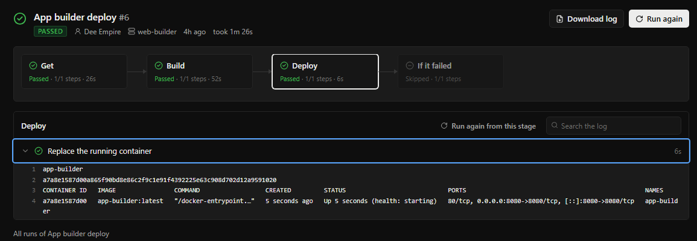
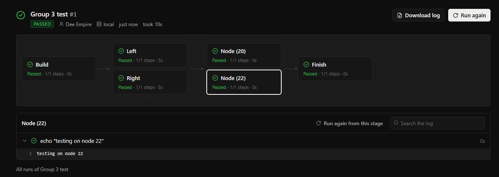
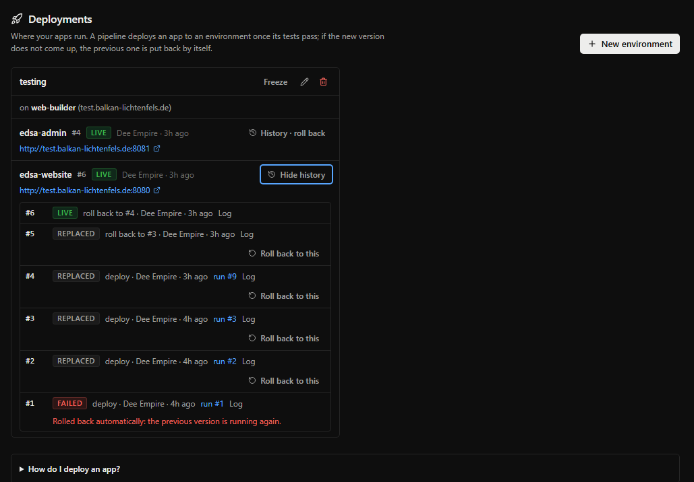

<div align="center">


# Zelyq

### The open-source developer platform for building, securing and shipping apps.

Build apps with an AI agent that works like an engineer. Keep every credential in one encrypted vault.
Test, build and deploy on your own machines — with pipelines, environments and automatic roll back.
**Self-hosted. Bring your own model. No telemetry.**

[](https://github.com/CrowPus/Zelyq/actions/workflows/ci.yml)
[](./LICENSE)
[](https://nodejs.org)
[](./tsconfig.base.json)
[](./CONTRIBUTING.md)

**[Live demo](https://zelyq.com)** · [Quickstart](#quickstart) · [Tutorial](./docs/tutorial.md) ·
[Documentation](./docs/README.md) ·
[Self-hosting](./docs/self-hosting.md) · [Architecture](./docs/architecture.md) ·
[Roadmap](./docs/roadmap.md) · [Contributing](./CONTRIBUTING.md)

<br />



<br />
<br />

<video src="https://github.com/user-attachments/assets/64062944-e922-4407-8a4c-91c85d9a452d" autoplay loop muted playsinline controls width="900"></video>

</div>

---

## One platform, from idea to production

Most teams stitch together an AI app builder, a secrets manager, a CI service and a deploy tool — four
products, four logins, four places for a key to leak. Zelyq is one self-hosted platform for the whole
path, organised the way the work happens:

| | Module | What it does |
| --- | --- | --- |
| **Build** | **[Apps](#build--apps-built-by-an-agent-that-works-like-an-engineer)** | Describe an app; an agent plans it, builds it in real files you own, and verifies it before calling it done |
| | **[Studio](#studio--images-and-video)** | Generate images and video — for your apps, or on their own |
| **Secure** | **[Vault](#secure--vault)** | Every credential once, encrypted, versioned and audited — used by apps, pipelines and your own servers |
| **Ship** | **[Pipelines](#ship--pipelines)** | Test and build the same way every time, on the Zelyq server or your own Linux, macOS and Windows machines |
| | **[Deployments](#ship--deployments)** | Put apps on your machines per environment, with approvals, freeze and automatic roll back |

Everything lives in **teams**: invite people, give them a role, and every module follows it.

<div align="center">
<br />

<video src="https://github.com/user-attachments/assets/d27ac811-30f6-4e97-b419-c087698a378e" controls muted loop playsinline width="900"></video>

</div>

---

## Build — apps built by an agent that works like an engineer



Describe what you want. The agent reads, plans, writes files, runs commands and starts a live preview —
and you watch every tool call and every file it touches as it happens.

- **Verified, not just generated.** When the agent finishes, Zelyq runs the project's own typecheck or
  build and checks the preview for a crash. A turn that broke something is handed back to fix — not
  reported as done.
- **Honest about what it knows.** *Engineer Mode* separates what was verified from what was inferred
  or assumed, names the alternative it did not choose, and asks instead of guessing on anything
  irreversible.
- **Plans before it builds.** *Architect Mode* turns a request into a reviewable design — requirements,
  decisions, data model, API, a build plan — and waits for your go-ahead. *Auto Mode* then runs the
  passes itself, to a hard limit.
- **Specialist agents.** A Designer (`DESIGN.md`), a DevOps engineer (CI, Dockerfile, deploy config),
  a Security/QA engineer (tests and a security scan) and a Cinematic engineer (scroll-driven heroes).
- **Full stack.** React + Vite, React with a Python (FastAPI) backend, or Expo React Native. Supabase Postgres with
  row-level security written per operation and verified by a second session.
- **Start from what exists.** Bring in an existing GitHub repository when you create the app;
  `/clone <url>` rebuilds a live site page for page; `/figma <link>` builds from a Figma frame, with
  its design tokens.
- **Every turn can be undone.** A snapshot before each turn, a diff of exactly what changed, and
  one-click revert. Project files are plain files on disk — `cd` into them and take them with you.

See [Modes](./docs/modes.md) and [how the agent decides what to do](./docs/agent-behaviour.md).

### Studio — images and video

<table>
<tr>
<td width="50%"></td>
<td width="50%"></td>
</tr>
<tr>
<td align="center"><sub><b>Image</b> — OpenAI, Google or xAI, with reference images and a private library.</sub></td>
<td align="center"><sub><b>Video</b> — Google Veo or xAI, from text or from a still image.</sub></td>
</tr>
</table>

Your keys, billed to your own provider account. Turn it on for a project and the agent can generate
artwork and footage for the app it is building — always within the limits you set. Clips can be split
into image sequences for scroll-driven heroes. See [Studio — Image](./docs/Image-gen/implementation.md)
and [Studio — Video](./docs/Video-gen/README.md).

---

## Secure — Vault



Keep each credential **once**, and use it everywhere — without ever pasting it into a file.

- **Encrypted at rest** (AES-256-GCM), with **version history**, a **Protected** flag for live keys,
  and an **audit trail** of every reveal and change.
- **Used by reference.** App variables, model keys in Settings, pipelines and deployments all point to
  `vault://NAME` — the value is filled in only where and when it is needed.
- **Masked everywhere.** A secret that reaches a pipeline log shows as `***`.
- **Your own servers too.** Fetch secrets with a scoped service key, or run
  `zelyq vault run -- <command>` to start a process with them and write nothing to disk.
- **Import a `.env`** to move in, and never read credentials from one again.

See [Vault](./docs/vault.md).

---

## Ship — Pipelines



A pipeline is a short YAML file: stages run in order, steps run in order, every step is a command.

```yaml
name: Shop
runs-on: local                      # the Zelyq server, or one of your machines over SSH
source: { app: Shop }
stages:
  - name: Test
    matrix: { node: [20, 22] }      # one copy per version, at the same time
    steps:
      - checkout: true
      - setup: node@${{ matrix.node }}
      - run: npm ci && npm test
        tests: reports/*.xml        # JUnit: passed / failed on the step
  - name: Deploy
    steps:
      - deploy: { to: production, port: 3000 }
```



- **Runs where you choose.** In a throwaway container on the Zelyq server, or on your own **Linux,
  macOS and Windows** machines over SSH, with each machine's fingerprint pinned.
- **Fast and flexible.** Stages that run at the same time, a different machine per stage, matrix builds,
  and reusable templates shared across pipelines.
- **Plugins.** Package a step once — with inputs, secrets from Vault and outputs — install it in your
  team and use it in any pipeline. See [Pipeline plugins](./docs/pipeline-plugins.md).
- **Started by anything.** By hand, a git push (with path filters), a pull request, a schedule, another
  pipeline finishing, an app change from the agent, or any CI with a service key.
- **Everything a real pipeline needs.** Tool setup and caches, service containers (Postgres, Redis),
  step outputs, JUnit test reports, artifacts, approvals, retries, timeouts and concurrency control.
- **Reports back.** ✓ / ✗ on the commit and the pull request in GitHub or GitLab, and notifications when
  a run ends.

See [Pipelines](./docs/pipelines.md).

## Ship — Deployments



- **Environments** such as `staging` and `production`, each on one of your machines, each with its own
  variables — the test key on staging, the live key on production, from Vault.
- **Deploy from a pipeline**, so an app is tested before it ships. Zelyq builds the image on your
  machine — from the app's `Dockerfile`, or one Zelyq writes for Node, Python, Go and static sites.
  No registry needed.
- **Automatic roll back.** If the new version does not pass its health check, the previous one is put
  back by itself.
- **One-click roll back** to any of the last three good versions, from the deploy history.
- **An app page** with its live logs, CPU and memory, and restart and stop.
- **Promote** the exact image tested on staging to production, without building it again.
- **Protected environments** wait for an admin's approval; **freeze** stops all deploys during a
  release.

See [Deploy](./docs/deploy.md).

---

## Quickstart

```bash
# Requires Node >= 20.12 and pnpm >= 9
git clone https://github.com/CrowPus/Zelyq.git
cd Zelyq
cp .env.example .env    # your configuration — edit it before the first start (below)
pnpm install
pnpm dev                # web :5173 · server :8787 · agent :8788
```

**Edit `.env` before you start.** Its defaults assume you open Zelyq on the same computer it runs
on, at `localhost`. On a VM or any remote server, change these — replace `203.0.113.10` with your
machine's address or domain:

| Setting | On a VM / server | Why |
| --- | --- | --- |
| `ZELYQ_WEB_HOST` | `0.0.0.0` | Otherwise the web UI only answers on the VM itself |
| `ZELYQ_PREVIEW_HOST` | `203.0.113.10` | Otherwise every app preview refuses your browser |
| `ZELYQ_CORS_ORIGIN` | `http://203.0.113.10:5173` | The address you open Zelyq at |
| `ZELYQ_PUBLIC_URL` | `http://203.0.113.10:5173` | Used in webhook and sign-in callback links |
| `ZELYQ_ALLOW_REGISTRATION` | `false`, once your account exists | Otherwise anyone who finds the address can sign up |

Open the preview ports (`ZELYQ_PREVIEW_PORT_MIN`–`MAX`, 4300–4399 by default) and 5173 in the VM's
firewall. On a machine reachable from the internet, put Zelyq behind HTTPS — see
[Self-hosting](./docs/self-hosting.md). Every other setting is explained in `.env.example` itself
and in [Configuration](./docs/configuration.md).

Open <http://localhost:5173> (or your VM's address) and create the first account — it administers
the instance. Add your model's key in `.env` or in **Settings → Model**, open **Apps**, create an
app and describe what you want.

Prefer containers? `docker compose -f docker/docker-compose.yml up` — see
[Self-hosting](./docs/self-hosting.md).

### Updating

Your data stays where it is. The database, generated images and videos, and the encryption key
live in `data/`, your apps in `workspace/`, and your settings in `.env` — Git ignores all three, so
pulling a new version never touches them, and the server applies any database changes itself when
it starts.

```bash
cd ~/Zelyq                                   # wherever you cloned it
# 1. Stop Zelyq (Ctrl+C if it runs as `pnpm dev` in a terminal)

# 2. Back up first, just in case
cp -a data ~/zelyq-data-backup-$(date +%F)
cp -a workspace ~/zelyq-workspace-backup-$(date +%F) 2>/dev/null
cp .env ~/zelyq-env-backup-$(date +%F) 2>/dev/null

# 3. Get the new version and rebuild
git pull
pnpm install
pnpm build

# 4. Start Zelyq again, the same way as before — e.g. `pnpm dev`
```

Run these as the user who cloned Zelyq. If Git stops with `detected dubious ownership`, you are
someone else (often `root`): switch with `su - <that user>` rather than adding the `safe.directory`
exception, which would leave root-owned files in the folder.

With Docker, `git pull` then `docker compose -f docker/docker-compose.yml up -d --build`. Your data
is in the `zelyq-data` volume — **never** run `docker compose down -v`, which deletes it.

More detail, including PostgreSQL: [Self-hosting → Upgrading](./docs/self-hosting.md#upgrading).

**Next:** the [tutorial](./docs/tutorial.md) takes an app from Zelyq to production, step by step —
Vault, a pipeline, your own machine, a deploy with roll back, and GitHub pushes and pull requests.

## Bring your own model

| Provider | `ZELYQ_PROVIDER` | Default model |
| --- | --- | --- |
| Claude | `anthropic` | `claude-opus-5` |
| Gemini | `google` | `gemini-3.7-flash` |
| OpenAI | `openai` | `gpt-5.1` |
| DeepSeek | `deepseek` | `deepseek-chat` |
| Mistral | `mistral` | `mistral-large-latest` |
| Grok (xAI), Groq, OpenRouter | `xai`, `groq`, `openrouter` | set `ZELYQ_MODEL` |
| **Your own** — Ollama, vLLM, LM Studio, anything OpenAI-compatible | `custom` | set `ZELYQ_MODEL` |

Keys are set in **Settings → Model**, typed or from Vault. With `custom`, nothing about your projects
ever leaves your network. See [Configuration](./docs/configuration.md).

## How it works

Three processes and a command-line tool, over four shared libraries. An app's files and commands
are reached through one seam only, the `RuntimeDriver`, which is what makes local and remote the
same.

```
   Browser                                 zelyq CLI  (zelyq vault run …)
      │                                        │
      │  REST + WebSocket                      │  HTTPS, service key
      ▼                                        ▼
 ┌──────────────────────────────────────────────────────────┐
 │ apps/server   Fastify · owns the database                │
 │ teams · apps · Vault · pipeline engine · deploys         │
 └────┬───────────────────────┬─────────────────────┬───────┘
      │ HTTP + SSE            │                     │ SSH (pinned fingerprint)
      ▼                       │                     ▼
 ┌──────────────┐             │             ┌────────────────────────────┐
 │ apps/agent   │             │             │ Runners and environments   │
 │ model loop,  │             │             │ your Linux, macOS, Windows │
 │ tools        │             │             │ machines: pipelines,deploys│
 └──────┬───────┘             │             └────────────────────────────┘
        │                     │  files, previews, snapshots
        ▼                     ▼
 ┌──────────────────────────────────────────────────────────┐
 │ RuntimeDriver   the only path to disk and shell          │
 │ local · container (one per project) · remote host        │
 └──────────────────────────────────────────────────────────┘
```

- **apps/web** is the UI: chat, editor and preview, Studio, Vault, Pipelines, Deployments.
- **apps/server** holds everything shared — teams, apps, Vault, the pipeline engine and deploys — and
  is the only process that talks to the database.
- **apps/agent** runs the model loop. It never touches files itself: every tool goes through the
  `RuntimeDriver`.
- **Pipelines** run on the Zelyq server (`runs-on: local`, a fresh container per run) or on your own
  machines over SSH; **deploys** go to your machines over SSH too.

| Package | Responsibility |
| --- | --- |
| [`@zelyq/core`](./packages/core) | Domain types, the pipeline file format and the wire protocol — shared by every process |
| [`@zelyq/runtime`](./packages/runtime) | `RuntimeDriver` and its implementations; the only code that starts processes |
| [`@zelyq/db`](./packages/db) | Drizzle schema and migrations — SQLite by default, PostgreSQL when you scale |
| [`@zelyq/tools`](./packages/tools) | The agent's tools, written once against `RuntimeDriver` |

Full detail: [Architecture](./docs/architecture.md).

## Teams and access

| Role | Can |
| --- | --- |
| `viewer` | See apps, files, runs, environments and deploy history |
| `editor` | Everything above, plus prompt the agent, run pipelines and deploy |
| `admin` | Everything above, plus members, environments, approvals and protected secrets |
| `owner` | Full control, including the team itself |

Every change — a secret revealed, a pipeline edited, a deploy rolled back — is in the team's Activity.

## Security

Zelyq is built to be inspected: boring storage, plain files, no telemetry, and secrets that are
encrypted at rest and never passed on a command line or written to a log. Two limits are worth
knowing before you deploy:

- **`local` runtime mode is not a sandbox.** Agent shell commands run as the server's user — use it
  for one trusted developer on one machine. For anything shared or internet-facing, use container
  isolation.
- **Container mode's outbound network is open by default.** It always blocks the cloud metadata
  endpoint and cross-project traffic; set `ZELYQ_CONTAINER_EGRESS_ALLOWLIST` to restrict the rest.

Read the [threat model](./SECURITY.md#threat-model--read-this-before-deploying) before deploying.

## Status

Zelyq is **early, and moving fast**. Apps, Studio, Vault, Pipelines and Deployments all work end to
end and are used daily. Expect breaking changes before `1.0`. See the [roadmap](./docs/roadmap.md).

## Contributing

Issues, discussions and pull requests are welcome. [CONTRIBUTING.md](./CONTRIBUTING.md) covers the dev
loop, the repository layout and where a change usually belongs. Everyone participating follows the
[Code of Conduct](./CODE_OF_CONDUCT.md).

## License

Zelyq is **open source** under the [GNU AGPL-3.0](./LICENSE): run it, modify it, self-host it, fork
it. If you run a *modified* Zelyq as a service for others over a network, the AGPL requires you to
offer them your source.

A **commercial license** — the same code without the AGPL's network-source requirement — is available
for closed-source products and organisations whose policy blocks AGPL software:
**support@dee-empire.com**. Features marked "Zelyq Enterprise" (`ee/` paths) are a separate
subscription under the [Zelyq Enterprise License](./LICENSE_EE.md). See [LICENSING.md](./LICENSING.md)
for the plain-language version. Releases up to and including `v0.1.0` remain available under
Apache-2.0.

<div align="center">
<br />

© 2026 [Dee Empire](https://dee-empire.com) · "Zelyq" and the Zelyq logo are trademarks of Dee Empire.

</div>
